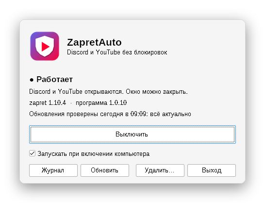

<p align="center">
  
</p>

<p align="center">
  <a href="https://github.com/DemonLibe/ZapretAuto-/releases/latest"></a>
  <a href="https://github.com/DemonLibe/ZapretAuto-/releases"></a>
  <a href="https://github.com/DemonLibe/ZapretAuto-/actions/workflows/release.yml"></a>
  
</p>

<h3 align="center">
  <a href="https://github.com/DemonLibe/ZapretAuto-/releases/latest/download/ZapretAuto.exe">⬇️ Скачать ZapretAuto.exe</a>
</h3>

<p align="center">Включил и забыл: программа сама обновляется, сама подбирает настройки под провайдера и живёт в трее.</p>

---

## 🚀 Как включить

1. Скачайте **[ZapretAuto.exe](https://github.com/DemonLibe/ZapretAuto-/releases/latest/download/ZapretAuto.exe)**.
2. Запустите его и нажмите **«Да»**.
3. Ответьте, запускать ли программу при включении компьютера. Рекомендуем **«Да»**.

Готово. Программа запустит обход, проверит, что Discord и YouTube открываются, и сама свернётся в трей к часам.
Ярлык **ZapretAuto** появится на рабочем столе и в меню «Пуск», так что скачанный файл можно удалить.

> [!TIP]
> Если Windows покажет «Система Windows защитила ваш компьютер», нажмите **Подробнее → Выполнить в любом случае**.
> Так бывает со всеми программами без платной цифровой подписи.

<p align="center">
  
</p>

## ✨ Что умеет

| | |
|---|---|
| 🔄 **Обновляется сама** | Проверяет новые версии zapret и свои при запуске, при открытии окна и каждые 6 часов. Ставит их тихо, без вопросов. Если новая версия не запустится, вернётся на прежнюю. |
| 🎯 **Подбирает настройки** | Перебирает все стратегии zapret и оставляет ту, при которой у вашего провайдера открывается больше всего. Если провайдер что-то поменял, перенастроится сама. |
| 🟢 **Живёт в трее** | Цветной значок значит «работает», серый — «выключен». Включить, выключить или закрыть можно одним кликом. |
| 🚦 **Автозапуск по желанию** | Галочка «Запускать при включении компьютера». Без неё обход работает, только когда вы сами нажмёте «Включить». |
| 🧹 **Удаляется начисто** | Не оставляет ни службы, ни драйвера, ни файлов, ни записей в автозагрузке. |
| 🤫 **Не мешает** | Никаких консольных окон и всплывающих браузеров, работает сама по себе. |

## 🖥️ Окно и значок в трее

Нажмите на значок в трее или откройте ярлык **ZapretAuto**. Крестик не закрывает программу, а прячет её обратно в трей.

- **Включить / Выключить**: одна кнопка, без запроса прав администратора.
- **Запускать при включении компьютера**: с галочкой при входе в Windows сразу запускаются обход и значок в трее.
- **Обновить**: проверить обновления прямо сейчас. Под статусом видно, когда проверяли и что нашлось.
- **Журнал**: подробный лог, если что-то пошло не так.
- **Выход**: полностью закрыть программу. Обход выключается, `winws.exe` и драйвер WinDivert останавливаются,
  и в памяти не остаётся ни одного процесса ZapretAuto. Тот же пункт есть в меню значка (правая кнопка мыши).

## 🗑️ Как удалить

**Параметры → Приложения → ZapretAuto → Удалить** или кнопка **«Удалить…»** в окне программы.

Удаляется всё: служба, драйвер WinDivert, значок в трее, скачанные файлы, настройки, журнал, ярлыки, автозагрузка,
исключение в Защитнике Windows и сама программа. Перезагрузка не нужна.

<details>
<summary><b>Удаление старой версии (v1.0.0)</b></summary>

В версии 1.0.0 ещё не было пункта в «Приложениях». Удалите её так:

1. Нажмите **Win + R**.
2. Вставьте строку и нажмите Enter:

```
C:\ProgramData\ZapretAuto\ZapretAuto.exe uninstall
```

3. Нажмите «Да» в запросе прав. Появится «ZapretAuto удалён».
4. Перезагрузите компьютер и удалите папку `C:\ProgramData\ZapretAuto`, если она осталась. Папка `ProgramData` скрытая: вставьте путь в адресную строку Проводника.

Можно и не удалять: новая версия при установке сама заменит старую.
</details>

## ❓ Частые вопросы

<details>
<summary><b>Как понять, что работает?</b></summary>

Значок ZapretAuto в трее цветной. Наведите на него мышь, и появится «ZapretAuto — работает».
</details>

<details>
<summary><b>Перестало работать</b></summary>

Ничего не делайте: программа сама проверяет доступность сайтов каждые 30 минут и подбирает новые настройки.
Если не помогло за час, удалите программу и включите снова.
</details>

<details>
<summary><b>Антивирус ругается</b></summary>

Это нормально для программ обхода блокировок: они перехватывают сетевые пакеты, поэтому антивирусы помечают их
как «потенциально опасное ПО».

- **Защитник Windows**: ZapretAuto сам добавляет свою папку в исключения.
- **Касперский, ESET, Dr.Web и другие** не дают программам менять свои настройки. Поэтому при установке ZapretAuto
  покажет короткую инструкцию и сам скопирует путь `C:\ProgramData\ZapretAuto`. Останется вставить его в исключения антивируса.
  Для Касперского: **Настройки → Настройки безопасности → Исключения и действия при обнаружении объектов →
  Управлять исключениями → Добавить** → вставить путь → отметить все компоненты.
- Если антивирус удалил сам скачанный `ZapretAuto.exe`, восстановите его из карантина и запустите снова.
</details>

<details>
<summary><b>Не работает вместе с VPN или другим обходом</b></summary>

Выключите VPN, GoodbyeDPI и другие «обходы»: они конфликтуют за перехват трафика.
Старую службу zapret из `service.bat` программа удаляет сама.
</details>

<details>
<summary><b>Что нового в последних версиях?</b></summary>

Смотрите **[CHANGELOG.md](CHANGELOG.md)** или описание каждого [релиза](https://github.com/DemonLibe/ZapretAuto-/releases).
</details>

## 🙏 Благодарности

ZapretAuto — это удобная оболочка. Вся работа по обходу блокировок делается этими проектами:

- [**zapret-discord-youtube**](https://github.com/Flowseal/zapret-discord-youtube) от Flowseal: готовые стратегии и списки;
- [**zapret**](https://github.com/bol-van/zapret) от bol-van: сам движок `winws`;
- [**WinDivert**](https://github.com/basil00/WinDivert) от basil00: драйвер перехвата пакетов.

---

<details>
<summary><b>Для продвинутых</b></summary>

ZapretAuto устанавливается как служба Windows `ZapretAuto`. Тип запуска «Автоматически» или «Вручную» зависит от галочки
автозапуска. Окно программы управляет службой: пользователям разрешено запускать и останавливать её без UAC, менять её настройки нельзя.

Служба:

- скачивает последний релиз Flowseal в `C:\ProgramData\ZapretAuto\releases\<версия>`;
- подбирает стратегию: пробует все `general*.bat` и оставляет ту, при которой открывается больше всего сайтов Discord и YouTube;
- запускает `winws.exe` скрыто, с аргументами из выбранного bat;
- проверяет обновления, свои и zapret, при каждом запуске, при открытии окна и дальше каждые 6 часов. При запуске сначала
  включается обход, потом идёт проверка. Интервал считается по часам компьютера, так что проверка не откладывается, пока компьютер спит.
  Неудачная проверка (например, интернет ещё не поднялся после включения) повторяется через 15 минут.
  Номер последней версии zapret берётся из `.service/version.txt`. Если тот недоступен, то со страницы последнего релиза на GitHub,
  затем через зеркало jsDelivr. Если обновление не запустится, служба откатывается на прежнюю версию.

Команды (консоль администратора): `ZapretAuto.exe status | update | select | uninstall | run`.

Настройки: `C:\ProgramData\ZapretAuto\config.json`.

| Поле | По умолчанию | Смысл |
|---|---|---|
| `strategy` | `""` | Зафиксировать стратегию, например `"general (ALT3)"`; пусто — автоподбор |
| `auto_select` | `true` | Подбирать стратегию автоматически |
| `update_interval_hours` | `6` | Частота проверки обновлений |
| `health_interval_minutes` | `30` | Частота проверки доступности сайтов (0 — не проверять) |
| `game_filter` | `"disabled"` | `disabled` / `all` / `tcp` / `udp` |

После изменения настроек: `sc stop ZapretAuto && sc start ZapretAuto`.

Лог: `C:\ProgramData\ZapretAuto\zapretauto.log`.

**Сборка:** `VERSION=v1.0.0 ./build.sh`. Иконка, манифест и сведения о версии лежат в `winres/` и вшиваются через
[go-winres](https://github.com/tc-hib/go-winres).

**Релизы** выпускаются автоматически при каждом изменении кода в `main`: номер версии повышается сам, тесты прогоняются
до публикации, а в описание релиза попадает раздел этой версии из [CHANGELOG.md](CHANGELOG.md). Поэтому перед изменением
кода добавьте в начало CHANGELOG раздел `## v<следующий номер> · <дата>`. Вручную релиз можно выпустить так:
**Actions → Release → Run workflow**.
</details>
